<p align="center">
  <a href="https://didulana.github.io">
    
  </a>
</p>

<p align="center">
  <a href="https://didulana.github.io"></a>
  <a href="https://www.linkedin.com/in/didulanalokugamage/"></a>
  <a href="mailto:didulanalokugamage@gmail.com"></a>
  <a href="https://didulana.github.io/Didulana_Lokugamage_CV.pdf"></a>
</p>

<p align="center"><em>I enjoy turning messy, real-world situations into systems people can depend on.</em></p>

## About me

- Third-year Computer Engineering undergraduate at the University of Peradeniya, Sri Lanka
- Committee member of ACES and co-editor of *GAUGE*, the engineering students' publication
- Looking for an internship with an experienced team, working on real production code

See my work, background and CV at **[didulana.github.io](https://didulana.github.io)**.

## Projects

| Project | What it is | Built with |
| --- | --- | --- |
| **[KidsRoute](https://github.com/cepdnaclk/e22-co2060-School-Van-Management-System)** | Live school-van tracking for parents, with real-time GPS and SOS alerts | React, TypeScript, Node.js, PostgreSQL, Socket.io |
| **[LexMed](https://github.com/Didulana/LexMed-Forensic-Medicine-Department-Database-System)** | Secure case records for a forensic medicine department, with role-based access and an audit log | MySQL, Node.js, Express, JWT |
| **Fabric Defect Detection** | Automated defect inspection for industrial fabric, placed 5th in a Kaggle competition | Python, LightGBM, PyTorch, OpenCV |

## Tech stack

**Languages**

<p>
  
  
  
  
  
</p>

**Frontend**

<p>
  
  
  
  
  
</p>

**Backend and real-time**

<p>
  
  
  
  
  
</p>

**Databases**

<p>
  
  
  
</p>

**Machine learning and data**

<p>
  
  
  
  
  
</p>

**Tools**

<p>
  
  
  
  
  
  
</p>

## Achievements

- **5th place**, Kaggle competition on Fabric Defect Detection & Localisation
- **Silver Medal & Merit Award**, Sri Lanka Junior Astronomy Olympiad
- **Merit Award**, Sri Lanka Physics Olympiad

**Certifications:** Google AI Essentials (Google) · Python for Beginners and Web Design for Beginners (University of Moratuwa) · Leadership & People Management (Semrush Academy)

## About this repository

This is the source of my portfolio, built with React 18, TypeScript, Vite, Tailwind CSS and Framer Motion, and deployed to GitHub Pages by GitHub Actions on every push to `main`.

<details>
<summary><strong>Run it locally, edit content, deploy</strong></summary>

### Run locally

```bash
npm install
npm run dev       # http://localhost:5173
npm run build     # type-check + production build into dist/
npm run preview   # serve the production build locally
```

Requires Node.js 18 or newer (CI uses Node 20).

### Editing content

All text lives in `src/data/`, so content changes don't need any layout code:

| File | What it controls |
| --- | --- |
| `profile.ts` | Name, links (email, GitHub, LinkedIn, CV), hero terminal lines, scrolling tool strip |
| `projects.ts` | Project cards: problem, what I did, stack, GitHub/demo links |
| `skills.ts` | Skill groups and where each was used |
| `experience.ts` | Leadership roles, awards, certifications |

Empty values in `profile.ts` (`email`, `linkedin`, `resumeUrl`) are hidden on the site automatically.

### Project structure

```
index.html            page shell, meta tags, fonts, theme pre-paint script
src/
  App.tsx             section order
  index.css           theme colours (light/dark CSS variables) and effects
  components/         one file per section, plus shared motion helpers
  data/               all site content
public/               static files served as-is (favicon, CV PDF)
.github/workflows/    GitHub Pages deployment
.github/assets/       README banner and animation (not shipped with the site)
```

To change the colour theme, edit the CSS variables at the top of `src/index.css`.

### Deployment

`.github/workflows/deploy.yml` installs dependencies, builds the site and publishes `dist/` to GitHub Pages whenever `main` is pushed. It can also be run manually from the **Actions** tab (“Run workflow”).

</details>

<br />

<p align="center">
  
</p>

<p align="center">
  <strong>Open to internship opportunities. Let's talk.</strong><br />
  <a href="https://didulana.github.io">didulana.github.io</a> · <a href="mailto:didulanalokugamage@gmail.com">didulanalokugamage@gmail.com</a>
</p>
